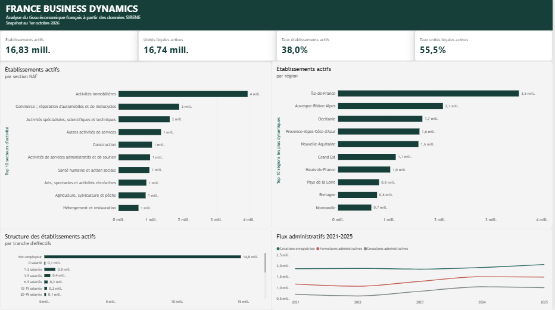
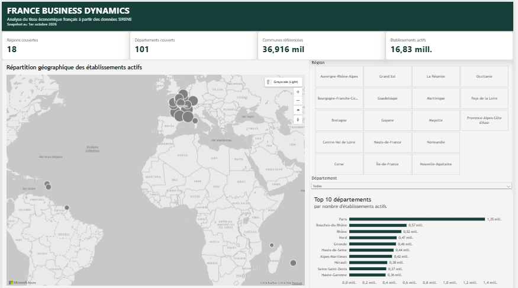
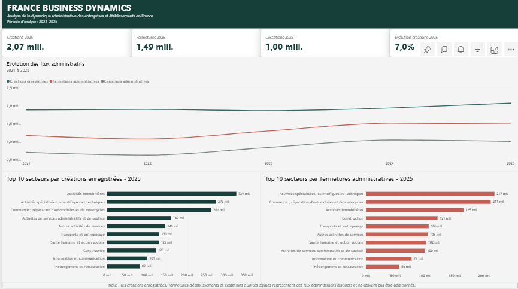
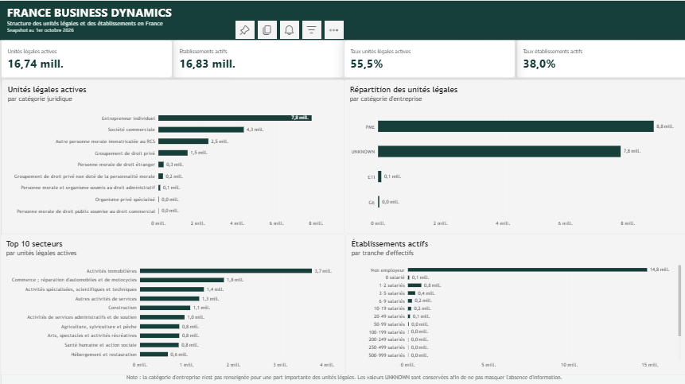

# France Business Dynamics — SIRENE Analytics


Projet end-to-end de **data engineering, analyse et Business Intelligence** construit à partir des données ouvertes SIRENE de l’Insee. Le pipeline transforme plusieurs centaines de millions de lignes brutes en couches Parquet validées, marts analytiques, modèle dimensionnel SQL Server et rapport Power BI destiné à l’analyse du tissu économique français.

> **Snapshot de référence : 1er octobre 2026**  
> **Fenêtre d’analyse des flux : 2021–2025**

## Contexte

SIRENE est le répertoire français des entreprises et de leurs établissements. Son volume, son historique, ses nomenclatures et ses particularités géographiques en font une source adaptée à un projet de portefeuille qui dépasse le simple dashboard : il faut télécharger, profiler, transformer, contrôler, modéliser et documenter les données avant de pouvoir les analyser correctement.

Le projet a donc été conçu comme une chaîne reproductible dans laquelle les fichiers bruts restent immuables, les transformations sont explicites et les résultats sont réconciliés avant leur exposition dans SQL Server et Power BI.

## Objectifs

La question directrice est : **comment se structure et évolue le tissu économique français à partir des données SIRENE ?**

Le projet répond notamment aux questions suivantes :

- combien d’unités légales et d’établissements sont actifs au snapshot de référence ;
- quels secteurs NAF concentrent le plus d’activité ;
- comment les établissements se répartissent par région, département et commune ;
- comment évoluent les créations enregistrées, fermetures d’établissements et cessations d’unités légales entre 2021 et 2025 ;
- comment se répartissent les unités légales par catégorie juridique et catégorie d’entreprise ;
- quelle est la structure des établissements selon les tranches d’effectifs ;
- quelles anomalies, valeurs inconnues et limites méthodologiques doivent être conservées et documentées plutôt que masquées.

## Résultats vérifiés

L’exécution complète sur le snapshot du 1er octobre 2026 a traité les quatre stocks SIRENE suivants :

| Source | Lignes |
|---|---:|
| Stock des unités légales | 30 148 401 |
| Stock des établissements | 44 282 364 |
| Historique des unités légales | 72 004 236 |
| Historique des établissements | 96 657 561 |
| **Total des lignes sources SIRENE** | **243 092 562** |

Après transformation :

- `unite_legale_current.parquet` : **30 148 401** lignes ;
- `etablissement_current.parquet` : **44 282 364** lignes ;
- `fact_establishment_snapshot.parquet` : **8 990 763** lignes agrégées ;
- `fact_legal_unit_snapshot.parquet` : **83 339** lignes agrégées ;
- `fact_administrative_events.parquet` : **14 208** lignes agrégées.

Le **Quality Gate** complet termine en `PASS` avec **0 FAIL** et **4 WARN** documentés, liés à des dates de création atypiques conservées pour traçabilité. Le chargement SQL réel représente **9 088 475 lignes de staging** et les contrôles SQL terminent à **13 PASS, 0 WARN, 0 FAIL**, avec réconciliation exacte des établissements, unités légales et événements.

## Sources

Sources officielles utilisées par le pipeline :

- `stock_unite_legale.parquet` — unités légales courantes — **30 148 401** lignes ;
- `stock_etablissement.parquet` — établissements courants — **44 282 364** lignes ;
- `stock_unite_legale_historique.parquet` — périodes historiques des unités légales — **72 004 236** lignes ;
- `stock_etablissement_historique.parquet` — périodes historiques des établissements — **96 657 561** lignes ;
- `v_commune_2026.csv` — référentiel géographique du Code officiel géographique 2026.

Les URL stables et le détail des sources sont documentés dans [`docs/source_reference.md`](docs/source_reference.md).

## Architecture

```text
INSEE / data.gouv.fr
        │
        ▼
Téléchargement reprenable
+ contrôles + SHA-256
        │
        ▼
      RAW
        │
        ├──────────────► REFERENCE / COG 2026
        │
        ▼
Profilage des sources
        │
        ▼
Transformation Polars
        │
        ▼
      CURATED
        │
        ▼
      MARTS
        │
        ▼
   Quality Gate
        │ PASS
        ▼
    SQL Server
 stg.* → analytics.*
        │
        ▼
     Power BI
```

Principes de conception :

- conservation des sources brutes sans modification ;
- traitement Parquet avec Polars et lecture lazy/streaming pour limiter l’usage mémoire ;
- séparation entre données courantes, historiques, références et marts analytiques ;
- contrôles avant chargement SQL ;
- modèle dimensionnel avant visualisation ;
- documentation explicite des anomalies au lieu de suppression silencieuse.

## Structure du projet

```text
france-business-dynamics/
├── data/{raw,processed,reference}/   données locales, hors Git
├── notebooks/                       profilage · analyse · contrôle qualité
├── src/france_business_dynamics/
│   ├── ingestion/                   sources, téléchargement, vérification, schémas
│   ├── transformation/              nettoyage, NAF, géographie, historiques, marts
│   ├── validation/                  qualité, schémas et structure du dépôt
│   ├── analysis/                    requêtes analytiques testées
│   └── utils/                       configuration, erreurs, JSON et manifestes
├── sql/                             création, staging, modèle analytique, vues, contrôles
├── dashboard/                       rapport Power BI, DAX, Power Query, thème et captures
│   ├── france-business-dynamics.pbix  rapport final Power BI (≈ 15,5 Mo)
│   └── screenshots/                  captures directes des 4 pages finales
├── docs/                            architecture, méthodologie, dictionnaire, qualité…
├── tests/                           suite automatisée et fixtures internes aux tests
├── .github/workflows/ci.yml         CI sans téléchargement des données lourdes
├── pyproject.toml
├── requirements.txt
├── requirements-lock.txt
├── .env.example
└── LICENSE
```

## Notebooks

| Notebook | Rôle |
|---|---|
| `01_source_profiling.ipynb` | Profilage en lecture seule des sources : schémas, nulls, doublons, états, NAF, dates et géographie. |
| `02_business_analysis.ipynb` | Réponses aux questions métier à partir des marts validés. |
| `03_quality_control.ipynb` | Présentation du rapport de qualité et des réconciliations du pipeline. |

La logique de production reste dans `src/` : les notebooks servent à l’exploration, à l’analyse et à l’explication.

## Installation

Python **3.13 ou 3.14**.

```powershell
python -m venv .venv
.\.venv\Scripts\Activate.ps1
python -m pip install --upgrade pip
python -m pip install -r requirements.txt
```

Pour Linux/macOS :

```bash
python3 -m venv .venv
source .venv/bin/activate
python -m pip install --upgrade pip
python -m pip install -r requirements.txt
```

Les versions directes sont fixées ; le verrou complet est disponible dans `requirements-lock.txt`.

## Vérification

Avant de télécharger plusieurs gigaoctets :

```powershell
python -c "import france_business_dynamics; print(france_business_dynamics.__version__)"
python -m pytest
python -m france_business_dynamics.validation.structure
```

La suite de tests vérifie notamment les contrats de schéma, la qualité, les téléchargements, les artefacts, le modèle SQL et la documentation. La CI exécute ces contrôles sans télécharger SIRENE.

## Méthodologie

Le pipeline sépare quatre niveaux : `RAW`, `REFERENCE`, `CURATED` et `MARTS`.

La transformation :

- conserve SIREN et SIRET comme chaînes ;
- normalise les chaînes vides en valeurs nulles lorsqu’elles représentent l’absence d’information ;
- convertit les dates dans des types explicites sans inventer de corrections ;
- enrichit la géographie à partir du COG 2026 ;
- conserve la nomenclature NAF associée à chaque code ;
- produit des indicateurs dérivés tels que statut actif, année de création, section NAF et tranches d’effectifs ;
- agrège les volumes destinés à SQL Server et Power BI sans perdre les totaux sources.

Les valeurs `UNKNOWN`, les géographies non résolues et les dates atypiques ne sont pas supprimées silencieusement : elles restent mesurables et documentées.

## Contrôle qualité

Le Quality Gate contrôle notamment :

- unicité et format de SIREN/SIRET ;
- cohérence `SIREN + NIC = SIRET` ;
- doublons ;
- états administratifs attendus ;
- cohérence des nomenclatures NAF ;
- rattachement géographique au COG ;
- dates de création non plausibles ;
- grain et comptages des marts ;
- réconciliation entre sources et agrégats ;
- conformité au contrat SQL.

Lors de l’exécution complète de référence :

- **93** dates de création d’établissements sont antérieures au 01/01/1900 ;
- **10 143** sont postérieures au snapshot ;
- **50** dates de création d’unités légales sont antérieures au 01/01/1900 ;
- **7 669** sont postérieures au snapshot.

Ces anomalies génèrent des `WARN`, pas une suppression automatique.

## Téléchargement des données officielles

Les quatre stocks SIRENE et le COG sont récupérés via les URL stables configurées dans le projet. Le téléchargeur gère les fichiers `.part`, la reprise lorsque HTTP Range est disponible, les tailles, le SHA-256 et les manifestes JSON.

### Vérifier les sources

```powershell
python -m france_business_dynamics.ingestion.check_sources
```

### Vérifier les tailles et l’espace disque

```powershell
python -m france_business_dynamics.ingestion.download_sources --all --dry-run
```

### Télécharger toutes les sources

```powershell
python -m france_business_dynamics.ingestion.download_sources --all
```

Pour une source précise :

```powershell
python -m france_business_dynamics.ingestion.download_sources --dataset stock_etablissement
```

En cas d’interruption :

```powershell
python -m france_business_dynamics.ingestion.download_sources --dataset stock_etablissement --resume
```

## Inspection du schéma

Après téléchargement :

```powershell
python -m france_business_dynamics.ingestion.inspect_schema --local
```

Comparer avec le snapshot versionné :

```powershell
python -m france_business_dynamics.ingestion.inspect_schema --compare docs/schema_snapshot_2026-10-01.json
```

Une dérive de schéma doit être examinée avant de relancer l’ETL.

## ETL

```powershell
python -m france_business_dynamics.transform
python -m france_business_dynamics.build_mart
```

Le pipeline produit les couches courantes et les marts analytiques dans `data/processed/`. Les marts représentent les mêmes populations que les couches sources mais à un grain adapté à l’analyse.

## Quality Gate

```powershell
python -m france_business_dynamics.quality_gate --strict
```

Artefacts principaux :

- `data/processed/quality_report.json` — résultat structuré des contrôles de qualité ;
- `data/processed/pipeline_manifest.json` — périmètre, fichiers, lignes et métadonnées du traitement ;
- manifestes de téléchargement `*.json` — URL résolue, taille, SHA-256 et statut de chaque source ;
- `docs/schema_snapshot_2026-10-01.json` — schéma de référence versionné.

Signification :

- `PASS` : contrôle satisfait ;
- `WARN` : anomalie connue ou statistique à documenter ;
- `FAIL` : violation d’intégrité ;
- `SKIPPED` : couche non contrôlée ou absente selon le contexte.

## SQL Server

Le modèle SQL sépare le staging `stg.*` du modèle analytique `analytics.*`.

Préparer la configuration locale :

```powershell
Copy-Item .env.example .env
```

Valider les données sans ouvrir de connexion SQL :

```powershell
python -m france_business_dynamics.load_to_db --dry-run
```

Puis exécuter l’ensemble du modèle :

```powershell
python -m france_business_dynamics.sql_runner --stage all --yes
```

Ordre exécuté :

```text
01_create_database.sql
→ 02_create_schema.sql
→ 03_create_dimensions.sql
→ 04_create_facts.sql
→ 05_analytical_views.sql
→ load_to_db
→ 06_load_mart.sql
→ 07_quality_checks.sql
```

Le run réel de référence a chargé **9 088 475** lignes dans les huit tables de staging. Les contrôles finaux SQL ont terminé à **13 PASS, 0 WARN, 0 FAIL**.

## Power BI

Le rapport final Power BI a été construit sur les tables `analytics.*` du modèle SQL Server validé. Il contient **quatre pages analytiques**, utilise un filtrage dimension → fait en sens unique et est fourni dans le dépôt sous :

```text
dashboard/france-business-dynamics.pbix
```

Le fichier `.pbix` fait environ **15,5 Mo** et constitue le livrable interactif final. Les requêtes Power Query, mesures DAX, relations, thème et captures restent également documentés afin que le modèle soit auditable sans dépendre uniquement du binaire.

### Modèle et particularités Power BI

Les relations principales du modèle sont :

- `FactEstablishmentSnapshot[DateKey]` → `DimDate[DateKey]` ;
- `FactEstablishmentSnapshot[CommuneCode]` → `DimGeography[CommuneCode]` ;
- `FactEstablishmentSnapshot[ActivityKey]` → `DimActivity[ActivityKey]` ;
- `FactEstablishmentSnapshot[WorkforceCode]` → `DimWorkforce[WorkforceCode]` ;
- `FactLegalUnitSnapshot[DateKey]` → `DimDate[DateKey]` ;
- `FactLegalUnitSnapshot[ActivityKey]` → `DimActivity[ActivityKey]` ;
- `FactLegalUnitSnapshot[LegalCategoryCode]` → `DimLegalCategory[LegalCategoryCode]` ;
- `FactAdministrativeEvents[ActivityKey]` → `DimActivity[ActivityKey]`.

Une dimension auxiliaire Power BI `DimRegionMap` contient les **18 régions valides** avec latitude/longitude explicites. Elle est reliée à `DimGeography` par `RegionCode` en relation `1 → *`. Elle évite les ambiguïtés de géocodification d’Azure Maps, notamment pour les régions ultramarines, tout en laissant les géographies non résolues présentes dans le modèle.

`DimWorkforce[WorkforceLabel]` est trié par `SortOrder`.

### Aperçu du rapport

<table>
<tr>
<td width="50%"></td>
<td width="50%"></td>
</tr>
<tr>
<td></td>
<td></td>
</tr>
</table>

### Page 1 — Vue d’ensemble

Répond à :

- combien d’établissements et d’unités légales sont actifs ;
- quels secteurs NAF concentrent le plus d’établissements actifs ;
- quelles régions concentrent le plus d’activité ;
- comment se répartissent les établissements par tranche d’effectifs ;
- quelle est la tendance générale des flux administratifs entre 2021 et 2025.

### Page 2 — Géographie

Répond à :

- comment les établissements actifs se répartissent territorialement ;
- quelles régions et quels départements concentrent le plus d’activité ;
- comment les KPI changent lors d’une sélection régionale ou départementale.

Le rapport utilise `DimRegionMap[Latitude]` et `DimRegionMap[Longitude]` pour la carte. Les géographies non résolues restent conservées dans les données mais ne sont pas présentées comme une région valide dans le slicer.

### Page 3 — Dynamique 2021–2025

Répond à :

- comment évoluent les créations enregistrées ;
- comment évoluent les fermetures administratives d’établissements ;
- comment évoluent les cessations administratives d’unités légales ;
- quels secteurs concentrent le plus de créations et de fermetures en 2025.

> Les créations enregistrées, fermetures d’établissements et cessations d’unités légales sont des **flux administratifs distincts** et ne doivent jamais être additionnés.

### Page 4 — Structure des entreprises

Répond à :

- quelles catégories juridiques dominent les unités légales actives ;
- quelle part appartient aux catégories `PME`, `ETI`, `GE` ou `UNKNOWN` ;
- quels secteurs dominent le stock d’unités légales actives ;
- comment se répartissent les établissements actifs par tranche d’effectifs.

La catégorie `UNKNOWN` est volontairement conservée : elle matérialise l’absence d’information et n’est pas masquée pour améliorer artificiellement la présentation.

Les détails de reconstruction et les mesures finales sont documentés dans [`dashboard/README.md`](dashboard/README.md) et [`dashboard/DAX_MEASURES.md`](dashboard/DAX_MEASURES.md).

## Qualité et reproductibilité

Le projet applique un contrat unique entre transformation et SQL : colonnes attendues, types, largeurs, nullabilité et règles de qualité. Les téléchargements produisent des manifestes SHA-256 et les sorties Parquet/JSON sont écrites de façon atomique.

Les tests couvrent notamment :

- identifiants et clés ;
- dates et états administratifs ;
- cohérence SIREN/SIRET ;
- géographie et nomenclatures NAF ;
- réconciliation entre couches ;
- contrat SQL ;
- reprise des téléchargements ;
- sécurité des chemins et secrets ;
- documentation et structure du dépôt.

## Limites méthodologiques

Les événements SIRENE représentent des **événements administratifs enregistrés**. Ils ne doivent pas être interprétés automatiquement comme faillites, mortalité d’entreprise ou taux de survie.

En particulier :

- les créations, fermetures et cessations sont trois séries différentes et ne doivent pas être additionnées ;
- une cessation d’unité légale peut entraîner la fermeture de plusieurs établissements ;
- les valeurs `UNKNOWN` sont conservées pour ne pas masquer l’absence d’information ;
- certaines dates de création sont atypiques ;
- une petite part des établissements ne peut pas être rattachée à une commune du COG 2026 ;
- le snapshot représente l’état du registre à une date donnée et ne reconstitue pas automatiquement un stock actif à chaque fin d’année historique.

Voir [`docs/methodology.md`](docs/methodology.md) pour le détail.

## NAF

Les codes d’activité sont conservés avec leur nomenclature explicite. La NAF Rev.2 n’est pas appliquée rétroactivement aux anciennes nomenclatures.

Le snapshot courant contient également les futurs codes NAF 2025 lorsqu’ils sont fournis par SIRENE. La transition officielle vers NAF 2025 est prévue au **1er janvier 2027** et constitue une évolution documentée du projet.

## Reproductibilité

- dépendances directes fixées ;
- verrou complet disponible ;
- données lourdes exclues de Git ;
- fichiers bruts téléchargeables depuis les sources officielles ;
- contrôles de schéma versionnés ;
- manifestes SHA-256 ;
- Quality Gate reproductible ;
- scripts SQL ordonnés ;
- CI sans téléchargement SIRENE.

## Validation initiale

La suite automatisée a déjà atteint **353 tests passants** sur la version corrigée du dépôt avant l’exécution finale des données réelles. La validation complète des données réelles a ensuite produit un **Quality Gate PASS avec 0 FAIL**, tandis que SQL Server a terminé à **13 PASS, 0 WARN, 0 FAIL**.

Le détail des validations techniques est conservé dans [`docs/FINAL_VALIDATION.md`](docs/FINAL_VALIDATION.md).

## État du projet

Le projet est **terminé et prêt à être publié** :

- téléchargement et vérification des sources officielles : ✅ ;
- profiling des données réelles : ✅ ;
- ETL Polars / Parquet sur les stocks complets : ✅ ;
- Quality Gate : ✅ `PASS`, **0 FAIL**, 4 WARN documentés ;
- marts analytiques : ✅ ;
- SQL Server réel et modèle dimensionnel : ✅ ;
- contrôles SQL finaux : ✅ **13 PASS, 0 WARN, 0 FAIL** ;
- notebooks : ✅ ;
- dashboard Power BI final à quatre pages : ✅ ;
- captures finales : ✅ `dashboard/screenshots/` ;
- fichier `.pbix` final : ✅ `dashboard/france-business-dynamics.pbix`.

Les fichiers de données brutes/traitées restent volontairement hors Git : ils sont reproductibles depuis les sources officielles. Le `.pbix`, les captures, la documentation et tout le code nécessaire à la reconstruction du pipeline sont versionnés.

## Licence

MIT — voir [`LICENSE`](LICENSE). Les données SIRENE et référentiels publics restent soumis aux conditions indiquées par leurs sources officielles.
