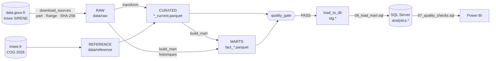
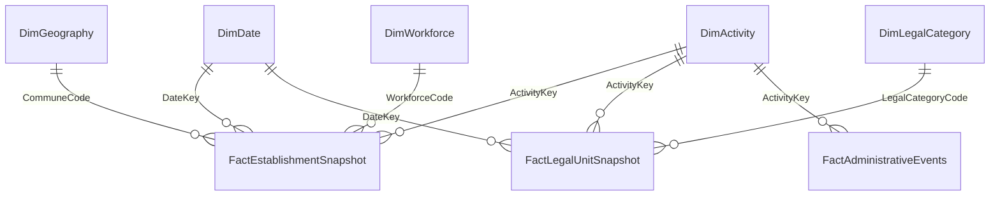

# Architecture

Ce document décrit **la structure technique** : couches, modules, modèle de données. Les définitions métier et leurs
limites sont dans [`methodology.md`](methodology.md) ; l'exploitation pas à pas dans
[`execution_checklist.md`](execution_checklist.md).

## Flux de bout en bout

| Couche | Dossier / schéma | Contenu | Produit par | Contrôlé par |
|---|---|---|---|---|
| **RAW** | `data/raw/` | stocks SIRENE tels que publiés (Parquet) + manifestes | `ingestion.download_sources` | `verify_parquet`, SHA-256, `inspect_schema` |
| **REFERENCE** | `data/reference/` | COG 2026 (CSV) | `ingestion.download_sources` | en-tête CSV, colonnes requises |
| **CURATED** | `data/processed/*_current.parquet` | une ligne par SIRET / SIREN, types et identifiants normalisés, NAF et géographie enrichies | `transform` | `quality_gate` (curated) |
| **MARTS** | `data/processed/fact_*.parquet` | tables de faits agrégées, grain explicite | `build_mart` | `quality_gate` (marts, réconciliation, contrat SQL) |
| **STAGING** | SQL Server `stg.*` | copie permissive des marts + référentiels | `load_to_db` | contrat SQL, schéma vivant, comptage |
| **ANALYTICS** | SQL Server `analytics.*` | modèle dimensionnel (étoile) strict | `06_load_mart.sql` | `07_quality_checks.sql` |
| **BI** | `dashboard/` | modèle Power BI, DAX, `DimRegionMap`, 4 pages analytiques | Power BI Desktop | réconciliation DAX ↔ SQL + captures finales |

Chaque flèche est une **étape autonome** avec ses préconditions : si une couche requise manque, la commande s'arrête
avant d'écrire quoi que ce soit, en indiquant la commande qui la produit.

## Modules du paquet (`src/france_business_dynamics/`)

| Module | Responsabilité |
|---|---|
| `utils/config.py` | chemins relocalisables (`FBD_DATA_DIR`), sources officielles, constantes d'analyse |
| `utils/errors.py` | `PipelineError` (message + action), codes de sortie 0/1/2, `run_cli` (jamais de traceback brut) |
| `utils/jsonio.py`, `utils/manifest.py` | écriture JSON atomique ; `pipeline_manifest.json` ; `sink_atomic` |
| `ingestion/downloader.py` | téléchargement robuste : `.part`, `Range`, reprise, SHA-256, manifeste |
| `ingestion/verify.py` | contrôles d'intégrité (octets magiques Parquet, pied de page, en-tête CSV) |
| `ingestion/sources.py`, `check_sources.py`, `inspect_schema.py` | statuts HTTP 302/200, schémas distants, dérive de schéma |
| `transformation/current.py` | normalisation (identifiants, dates, textes) — **sans filtrer aucune ligne** |
| `transformation/naf.py`, `workforce.py`, `legal.py`, `geo_labels.py` | nomenclatures et libellés |
| `transformation/geography.py` | lecture COG, héritage `COMPARENT`, jointure, `geo_status` |
| `transformation/historical.py` | reconstruction des changements d'état à partir des périodes |
| `transformation/marts.py`, `pipeline.py` | assemblage des couches et des tables de faits |
| `validation/schemas.py` | colonnes retenues par source + `require_columns` |
| `validation/quality.py`, `quality_gate.py` | moteur de contrôles et orchestration par couche |
| `validation/profile.py` | perfilage pour le notebook 01 |
| `analysis/queries.py` | requêtes analytiques pour le notebook 02 |
| `sql_contract.py` | **contrat de staging** : colonnes, types, largeurs, nullabilité |
| `sqlconn.py`, `load_to_db.py`, `sql_runner.py` | connexion, chargement par lots, exécution des scripts SQL |
| `tests/support/fixture_data.py` | données synthétiques isolées utilisées uniquement par les tests, fidèles au schéma réel (sans téléchargement) |

## Principes de conception

1. **Lazy et streaming — mesurés.** Les stocks (44 M / 96 M de lignes) ne tiennent pas confortablement en mémoire : tout
   passe par `scan_parquet`, sélection précoce des colonnes, filtres précoces (pushdown) et `sink_parquet`. Aucun
   `collect()` sur un stock complet, et les agrégations utilisent `collect(engine="streaming")`. Attention : certaines
   expressions (`is_in` sur chaînes, `replace_strict`) font silencieusement perdre le streaming — elles sont interdites
   par des tests (`tests/test_streaming_safety.py`) ; voir `technical_decisions.md` pour les mesures.
2. **Aucune logique de production dans les notebooks.** Ils appellent `validation/profile.py` et `analysis/queries.py`
   (testés) et refusent de s'exécuter si le quality gate n'est pas `PASS`.
3. **Erreurs contrôlées.** Chaque défaillance attendue est une `PipelineError` : *ce qui s'est passé* + *l'action à
   mener*. Codes de sortie : `0` succès · `1` contrôle ou exécution en échec · `2` précondition manquante.
4. **Écritures atomiques.** Parquet, JSON et téléchargements passent par un fichier temporaire (`.tmp` / `.part`) : un
   fichier final existe uniquement s'il est complet.
5. **Un seul contrat SQL.** `sql_contract.py` définit les colonnes de staging ; un test compare le DDL de
   `sql/04_create_facts.sql` à ce contrat ; `load_to_db` revérifie le schéma *vivant* avant d'insérer.
6. **Reconstruction déterministe plutôt que patchs.** `03` et `04` font `DROP` puis `CREATE` : rejouer ces scripts remet
   toujours la base d'équerre (l'ancien « créer si absent » conservait des tables trop étroites).

## Modèle de données SQL Server

Le **staging** (`stg`) est large et permissif ; le **modèle analytique** (`analytics`) est strict (clés, contraintes).

| Table | Grain / clé | Mesure |
|---|---|---|
| `FactEstablishmentSnapshot` | date × commune × activité × effectifs × état | `EstablishmentCount` |
| `FactLegalUnitSnapshot` | date × activité × catégorie juridique × catégorie d'entreprise × état | `LegalUnitCount` |
| `FactAdministrativeEvents` | année × type d'entité × type d'événement × activité | `EventCount` |
| `DimActivity` | `ActivityKey` ; unique `(NafNomenclature, NafCode)` | — |

`DimActivity` est indexée par **(nomenclature, code)** et non par code seul : un même code peut exister dans deux nomenclatures sans signification commune. Colonnes, types et largeurs : [`data_dictionary.md`](data_dictionary.md).

### Couche Power BI

Power BI importe les 8 tables `analytics.*`. Une table locale `DimRegionMap` (18 lignes) complète le modèle uniquement pour la cartographie : elle porte `RegionCode`, `RegionName`, `Latitude` et `Longitude`, puis filtre `DimGeography` par une relation `1 → *`. Cette décision évite de dépendre du géocodage implicite des noms de régions et rend explicite le traitement des territoires ultramarins.

Le rapport final comporte 4 pages : **Vue d’ensemble**, **Géographie**, **Dynamique 2021–2025** et **Structure des entreprises**.

## Ce qui n'est pas dans l'architecture (volontairement)

* Pas d'orchestrateur (Airflow, etc.) : un pipeline mensuel local se lance à la main ; voir [`roadmap.md`](roadmap.md).
* Pas de service SQL dans la CI : les tests utilisent une émulation contrôlée, tandis qu’une exécution complète a également été validée sur un SQL Server réel ; voir [`sql_server.md`](sql_server.md).
